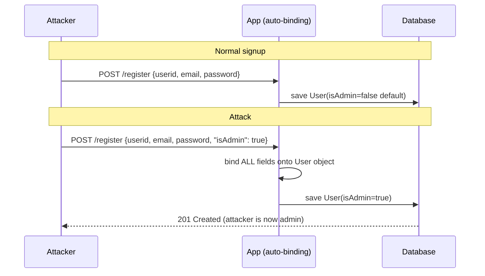
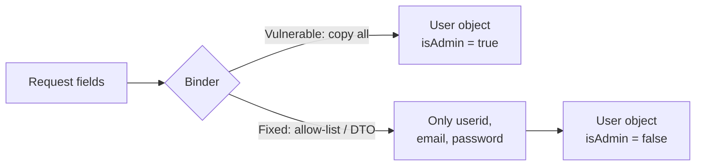

---
video:
lab: https://portswigger.net/web-security/api-testing/lab-exploiting-mass-assignment-vulnerability
owasp_cheatsheet: https://cheatsheetseries.owasp.org/cheatsheets/Mass_Assignment_Cheat_Sheet.html
---

# Mass Assignment

**Also called:** Autobinding (Spring, ASP.NET), Object injection (PHP), Mass Assignment (Rails, Node).
**Maps to:** [CWE-915](https://cwe.mitre.org/data/definitions/915.html) and **OWASP API3:2023 – Broken Object Property Level Authorization**.

## In one line
The app copies *everything* the user sends into its object, so the user can set fields they were never meant to touch (`isAdmin`, `price`, `balance`).

## Real-life analogy (India)
You fill the **IRCTC / Aadhaar update form**. It shows 3 boxes: name, mobile, email.
A clerk who types *whatever you tell him* into the system will also happily write
"Quota: VIP, Fare: ₹0" if you say it aloud. The form never showed those boxes, but the
clerk didn't check.

The fix: the clerk only accepts the 3 things on the form and ignores the rest.

## Why it happens
Frameworks save developer time by auto-binding request data to objects:

```
name=Ravi&email=r@x.in   →   user.name = "Ravi"; user.email = "r@x.in"
```

The framework does not know which fields are "safe". If the object also has `isAdmin`,
and the attacker sends `isAdmin=true`, the framework binds that too.
**The attacker needs no source code**: field names are guessable (`role`, `isAdmin`, `price`)
or leaked in API responses.

## Diagram: normal vs attack





## The classic example (from OWASP)

Form shows only `userid`, `password`, `email`. Backing class also has `isAdmin`:

```java
public class User {
   private String userid;
   private String password;
   private String email;
   private boolean isAdmin;   // never shown on the form
}

@RequestMapping(value = "/addUser", method = RequestMethod.POST)
public String submit(User user) {      // Spring auto-binds ALL request params
   userService.add(user);
   return "successPage";
}
```

Normal request:
```text
POST /addUser
userid=bobbytables&password=hashedpass&email=bobby@tables.com
```
Attack: one extra parameter.
```text
POST /addUser
userid=bobbytables&password=hashedpass&email=bobby@tables.com&isAdmin=true
```

## More realistic Indian e-commerce examples

| Endpoint | Field attacker adds | Impact |
|---|---|---|
| `POST /signup` | `"role":"admin"` | Admin account |
| `PUT /profile` | `"walletBalance":100000` | Free money |
| `POST /cart/item` | `"price":1`, `"discount":99` | Buy at ₹1 |
| `PUT /order/123` | `"status":"REFUNDED"` | Fraudulent refund |
| `PUT /seller/me` | `"kycVerified":true` | Skip KYC |
| `PUT /user/me` | `"userId":"<someone else's>"` | Account takeover / data overwrite |
| `POST /org/keys` | `"orgId":"<other org>"` | Cross-tenant access (the type of flaw behind the **2012 GitHub breach**) |

## Runnable demo (local only)

Source: [`examples/mass-assignment/app.py`](https://github.com/rootranjan/appsec-simplified/blob/main/examples/mass-assignment/app.py)

```bash
python3 examples/mass-assignment/app.py --selftest
```
Output:
```text
vuln: {'userid': 'bobby', 'email': 'b@x.in', 'is_admin': True,  'wallet_balance': 100000}
safe: {'userid': 'bobby', 'email': 'b@x.in', 'is_admin': False, 'wallet_balance': 0}
```

The core difference:

```python
# Vulnerable: copy every key the client sent
for key, value in data.items():
    setattr(user, key, value)

# Fixed: copy only allow-listed keys
ALLOWED = {"userid", "email", "password"}
for key in ALLOWED & data.keys():
    setattr(user, key, data[key])
```

To try it with curl while the server runs (`python3 examples/mass-assignment/app.py`):
```bash
curl -s -X POST localhost:8000/vuln/register -d '{"userid":"a","is_admin":true}'
curl -s -X POST localhost:8000/safe/register -d '{"userid":"a","is_admin":true}'
```

## How attackers find it (testing guide)

Use this on labs, CTFs and apps you are authorized to test.

1. **Read responses.** `GET /api/user/me` returns `{"id":1,"email":"..","isAdmin":false,"credit":0}`?
   Those extra fields are your candidate list.
2. **Replay writes with extra fields.** In Burp Repeater, take `PUT/PATCH/POST` requests and add
   `"isAdmin":true`, `"role":"admin"`, `"credit":9999`, `"price":1`, `"verified":true`, `"id":<other>`.
3. **Check the result.** Re-fetch the object. A `200 OK` alone proves nothing; the field must actually change.
4. **Try every format.** JSON `{"a":1}`, form `a=1`, nested `user[role]=admin`, `user.role=admin`, arrays.
5. **Try nested objects.** `{"profile":{"isAdmin":true}}`.
6. **Guess names from docs/JS/Swagger/GraphQL schema/mobile app.** Param Miner (Burp extension) can brute-force hidden params.
7. **Compare roles.** Fields visible only in an admin's response are good guesses.
8. **Try different verbs.** Create may be protected while update isn't.

**PortSwigger lab:** [Exploiting a mass assignment vulnerability](https://portswigger.net/web-security/api-testing/lab-exploiting-mass-assignment-vulnerability) (Practitioner, API testing). See "What I learned" below.

## How to fix it

Best to worst:

1. **DTOs (separate input objects)**: the request binds to a class that contains *only* editable fields.
   ```java
   public class UserRegistrationFormDTO {
       private String userid;
       private String password;
       private String email;
       // no isAdmin: it cannot be bound
   }
   ```
   Then map DTO → entity yourself and set sensitive fields in server code.
2. **Allow-list the fields** your framework can bind (see table below).
3. **Reject unknown fields** (strict parsing), so attacks are loud, not silent.
4. **Block-lists are weak.** `disallowedFields("isAdmin")` misses the next sensitive field added by a developer. Use only as a stopgap.
5. **Never trust client for sensitive values.** Price, role, balance, ownership come from the server/DB.
6. **Authorization still required.** DTOs control *which fields*; you still must check *whose object* and *which operation* ([Authorization Cheat Sheet](https://cheatsheetseries.owasp.org/cheatsheets/Authorization_Cheat_Sheet.html)).
7. **Return DTOs too** (response side), so you don't leak field names that help attackers.

### Allow-list per framework

=== "Spring MVC"
    ```java
    @InitBinder
    public void initBinder(WebDataBinder binder) {
        binder.setAllowedFields("userid", "password", "email");
    }
    ```
    Prefer a DTO as the `@RequestBody`/`@ModelAttribute` type.

=== "Node + Mongoose"
    ```javascript
    const _ = require('underscore');
    const SAFE = ['userid', 'password', 'email'];
    const user = new User(_.pick(req.body, SAFE));   // isAdmin dropped
    ```
    With Express, never do `new User(req.body)` or `User.update(id, req.body)`.

=== "Ruby on Rails"
    ```ruby
    def user_params
      params.require(:user).permit(:userid, :password, :email)  # strong parameters
    end
    User.create(user_params)
    ```

=== "Django / DRF"
    ```python
    class UserSerializer(serializers.ModelSerializer):
        class Meta:
            model = User
            fields = ["userid", "email"]          # explicit list
            read_only_fields = ["id"]
    # Avoid: fields = "__all__"  or  exclude = [...]
    ```

=== "Laravel"
    ```php
    protected $fillable = ['userid', 'password', 'email'];   // allow-list
    // Avoid: protected $guarded = [];   (everything mass-assignable)
    ```

=== "ASP.NET Core"
    ```csharp
    public IActionResult Create([Bind("UserId,Email,Password")] User user) { ... }
    // Better: bind to a ViewModel/DTO without IsAdmin.
    ```

=== "Jackson (Java JSON)"
    ```java
    @JsonIgnoreProperties(ignoreUnknown = false)   // fail on extra fields
    public class UserDto { String userid; String email; }
    // Or mark the sensitive field: @JsonProperty(access = READ_ONLY)
    ```

=== "FastAPI / Pydantic"
    ```python
    class UserIn(BaseModel):
        model_config = ConfigDict(extra="forbid")   # reject unknown fields
        userid: str
        email: EmailStr
        password: str
    ```

## For code review / ASPM (finding it at scale)

Red flags to grep for:

| Stack | Pattern |
|---|---|
| Node | `new Model(req.body)`, `Model.update(..., req.body)`, `Object.assign(user, req.body)`, `{...req.body}` |
| Spring | Controller param is a JPA `@Entity`; `@ModelAttribute` / `@RequestBody` on entity classes |
| Rails | `params.permit!`, `update(params[:user])` |
| Django | `fields = "__all__"`, `exclude = [...]` |
| Laravel | `$guarded = []`, `Model::create($request->all())` |
| .NET | Entity used directly as action parameter |
| Python | `setattr(obj, k, v)` loops over request data |

**Triage tips**
- Severity depends on *which field* is writable: role/ownership/price = high; display name = not an issue.
- Check whether entities with sensitive fields are ever used as request types.
- Write a Semgrep rule per pattern above; verify with a PoC on a test environment before raising.

**Tests to add:** for each write endpoint, a test that sends extra sensitive fields and asserts they don't change.

## Related bugs (don't confuse)

| Bug | Difference |
|---|---|
| IDOR | Attacker changes *which object* (`/orders/123`). Mass assignment changes *which fields*. |
| Prototype pollution | JS-specific; attacker sets `__proto__` key. Related idea: merging untrusted keys into objects. |
| Excessive data exposure | Server *returns* too many fields. Same root cause on the response side. API3:2023 covers both. |

## Quick revision

- Cause: auto-binding + sensitive fields on the same object.
- Exploit: add extra field to request.
- Fix: **DTO + allow-list**, never trust client for role/price/owner.
- Still do authorization.
- Test: add fields found in responses.

## What I learned from the lab

Lab: [Exploiting a mass assignment vulnerability](https://portswigger.net/web-security/api-testing/lab-exploiting-mass-assignment-vulnerability) (Practitioner). Goal: buy an expensive item you can't afford.
Notes below are concepts distilled from PortSwigger's [API testing page](https://portswigger.net/web-security/api-testing) and public write-ups (e.g. [siunam321](https://siunam321.github.io/ctf/portswigger-labs/api-testing/api-3/), [hndgoncer](https://medium.com/@hndgoncer/exploiting-a-mass-assignment-vulnerability-by-ports-d90b4e72ee2a)). I'm not republishing the solution; do the lab yourself first.

- **Spot hidden fields by comparing GET vs write requests.** The same endpoint's `GET` response contained a field (a discount choice) that the normal `POST` never sent. A field the server *returns* but the client never *sends* is a prime candidate.
- **3-step confirmation** (PortSwigger's method):
    1. Send the field with a harmless, valid-looking value. No error means it may be accepted.
    2. Send an invalid value (wrong type). If the response changes (error), the server parses and *uses* the field.
    3. Send a privileged value and check the real effect (price, role, access), not just the status code.
- **A type error is a useful oracle.** It proves the field reaches business logic even though the UI never shows it.
- **Root cause:** the backend bound request JSON straight to an internal object with no allow-list of editable properties.
- **Fix:** allow-list editable properties (DTO), keep price/discount/role decisions server-side, reject unknown fields.
- **Takeaway for ASPM:** responses leak the attack surface. Returning internal fields helps attackers (API3 covers this) and signals a binding risk on the write side.

### Real-world case: GitHub, 2012
A user exploited mass assignment on GitHub's public-key update form and added their SSH key to the `rails` organization, then pushed a commit to the project as a demonstration. GitHub removed the key, suspended the user, shipped a fix about an hour later, ran a log/database review, and audited the codebase for similar flaws.
Source: [GitHub blog: Public Key Security Vulnerability and Mitigation](https://github.blog/news-insights/company-news/public-key-security-vulnerability-and-mitigation/).
Lesson: even a mature team missed one form, so allow-lists must be enforced on every binding point.

---
Credit: based on the [OWASP Mass Assignment Cheat Sheet](https://cheatsheetseries.owasp.org/cheatsheets/Mass_Assignment_Cheat_Sheet.html) (CC BY-SA 4.0), rewritten with added examples. This note is shared under the same license.
