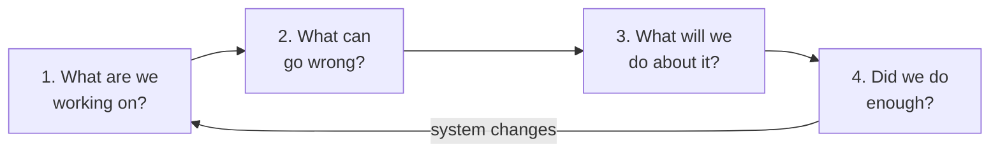

# Threat Modeling 101: Zero to Hero (Part 1)

**Series:** 1 Basics (this page) · [2 Frameworks](02-frameworks.md) · [3 Run a session](03-process.md) · [4 Worked example: office vending machine](04-vending-machine.md) · [5 Automation and tools](05-automation.md)

## In one line
Think like an attacker **on paper, before the system is built**, so you fix design flaws while they are cheap.

## Real-life analogy (India)
Before buying a flat, you check: Who has the spare key? Is the main gate guarded at night?
Can someone climb from the neighbour's balcony? Is the lift the only way out in a fire?
You did **not** wait for a robbery to learn these. That is threat modeling for a house.

## Why do it
- A design flaw found in design costs a meeting. Found in production, it costs an incident.
- Scanners find *bugs* (SQLi, outdated libs). They cannot find *design flaws* ("anyone can call the refund API", "service mode has a default code").
- It gives the team a shared picture of the system and its trust boundaries.
- For an AppSec/ASPM role, it is how you decide **where to spend limited review and testing effort**.

## The 4 questions (everything else is detail)
These come from the [Threat Modeling Manifesto](https://www.threatmodelingmanifesto.org/) and the [OWASP Threat Modeling Cheat Sheet](https://cheatsheetseries.owasp.org/cheatsheets/Threat_Modeling_Cheat_Sheet.html).

| # | Question | You produce |
|---|---|---|
| 1 | What are we working on? | Diagram (DFD), assets, assumptions, scope |
| 2 | What can go wrong? | List of threats (use STRIDE, attack trees, etc.) |
| 3 | What are we going to do about it? | Mitigations, owners, decisions |
| 4 | Did we do a good enough job? | Review, tests, follow-ups |

## Vocabulary you must know

| Term | Meaning | Vending machine example |
|---|---|---|
| **Asset** | Something worth protecting | Cash, stock, payment integrity, firmware |
| **Threat actor** | Who might attack | Curious employee, thief, rogue operator, remote attacker |
| **Threat** | Something bad that could happen | Fake payment confirmation gets a free item |
| **Vulnerability** | Weakness that lets the threat happen | Payment callback is not signed |
| **Risk** | Likelihood × impact of a threat | Likely, repeatable, small loss each time |
| **Mitigation / control** | What reduces the risk | Verify payment server-side before dispensing |
| **Attack surface** | All the places an attacker can interact | Keypad, coin slot, USB, 4G modem, APIs |
| **Trust boundary** | Line where data moves between different trust levels | Lobby ↔ locked cabinet; machine ↔ internet |
| **DFD** | Data Flow Diagram: processes, stores, external entities, flows, boundaries | See part 4 |

**Remember:** threat → exploits a vulnerability → harms an asset → risk is how bad × how likely.

## CIA and the properties STRIDE attacks
- **C**onfidentiality: only the right people can read it.
- **I**ntegrity: only the right people can change it.
- **A**vailability: it works when needed.
- Plus **authentication** (who are you), **authorization** (what may you do), **non-repudiation/accountability** (you can't deny what you did).

## Trust boundaries (the most useful idea)
Data crossing a trust boundary is where most attacks happen. Ask at every boundary:
*Who is on the other side? Do I verify them? Do I validate what they send?*

Examples: browser ↔ server, service ↔ third-party API, public lobby ↔ locked cabinet, office network ↔ internet.

## When and who
- **When:** at design time, and again whenever the design changes (new feature, new integration, new data, new user type).
- **Who:** developers, architect, QA, product, and security **together**. A security-only model misses how the system really works.
- **How long:** a small feature can take 30–60 minutes. Start small and iterate.

## What a good output looks like
One short document in the repo, next to the code:
1. Scope, assumptions, assets
2. Diagram with trust boundaries
3. Threat table: ID, threat, risk, response, owner, status
4. Security requirements and tests derived from it
5. Open questions

## Common mistakes (anti-patterns)
From the Manifesto and practice:
- **One-time exercise.** The system changes; the model must too.
- **Hero modeler.** One expert does it alone. Anyone on the team can do it.
- **Perfect diagram syndrome.** A rough whiteboard sketch beats a late perfect one.
- **Only listing threats.** Every threat needs a decision: mitigate, eliminate, transfer or accept.
- **Only copying checklists.** Checklists help, but you still must think about *your* system.
- **Ignoring physical and human threats** when the system has a physical part.

## Threat modeling vs other activities

| Activity | Finds | When |
|---|---|---|
| Threat modeling | Design flaws, missing controls | Design |
| Code review / SAST | Coding bugs | Build |
| Pen test / DAST | Exploitable issues in a running system | Test |
| Risk assessment | Organisation-level risk | Governance |

They complement each other. A threat model tells the pen tester *where to look*.

## Quick revision
- Threat modeling = structured "what can go wrong" before it does.
- 4 questions: build, wrong, fix, enough.
- Draw the system, mark trust boundaries, apply STRIDE per element, decide on each threat, test, repeat.

Next: [Part 2: Frameworks](02-frameworks.md)

---
Credit: structure follows the [OWASP Threat Modeling Cheat Sheet](https://cheatsheetseries.owasp.org/cheatsheets/Threat_Modeling_Cheat_Sheet.html) (CC BY-SA 4.0) and the Threat Modeling Manifesto, paraphrased; examples are my own.
