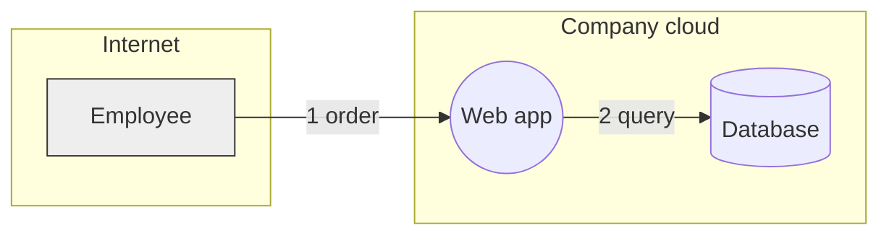
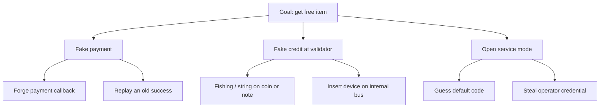
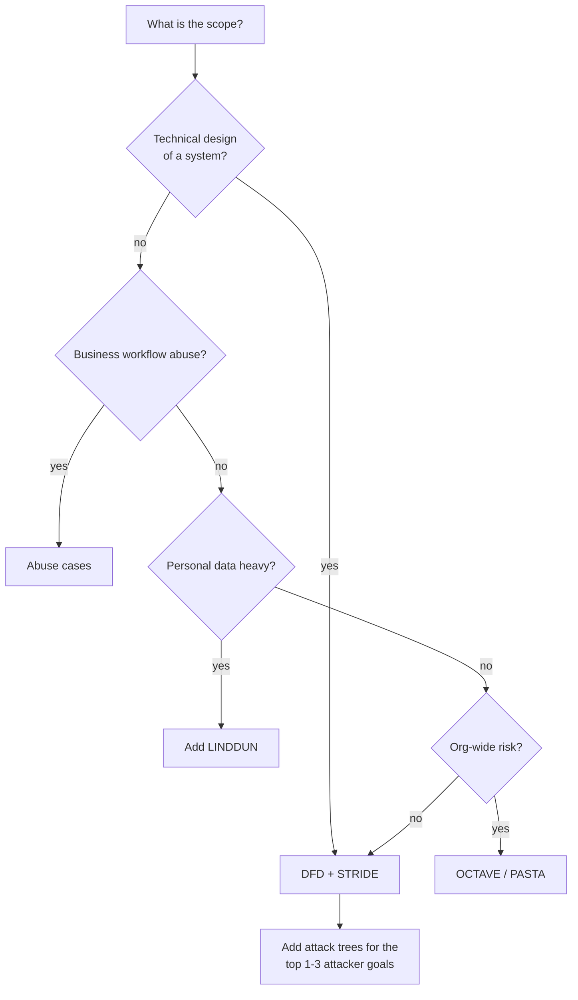

# Threat Modeling Frameworks (Part 2)

**Series:** [1 Basics](01-basics.md) · 2 Frameworks (this page) · [3 Run a session](03-process.md) · [4 Vending machine](04-vending-machine.md) · [5 Automation](05-automation.md)

## First: "framework" means three different things
| Layer | Question it answers | Examples |
|---|---|---|
| **Modeling** (what are we building) | How do I draw the system? | DFD, sequence diagram, attack tree |
| **Threat finding** (what can go wrong) | How do I not forget threats? | STRIDE, LINDDUN, attack trees, card games, CAPEC/ATT&CK |
| **Process / risk** (what matters) | How do I run it and rank it? | PASTA, OCTAVE, VAST, Trike, DREAD, CVSS |

There is no single standard. [OWASP's cheat sheet](https://cheatsheetseries.owasp.org/cheatsheets/Threat_Modeling_Cheat_Sheet.html) advises starting with **STRIDE for technical designs** and adding others only when the scope needs them. The [SEI summary of methods](https://www.sei.cmu.edu/library/threat-modeling-a-summary-of-available-methods/) compares them.

## 1. Data Flow Diagram (DFD): the base for almost everything

Five symbols:

| Symbol | Meaning | Example |
|---|---|---|
| Rectangle | External entity (outside your control) | Employee, payment provider |
| Circle / rounded box | Process (code that runs) | Controller firmware, API |
| Two parallel lines | Data store | Database, config file |
| Arrow | Data flow | "Payment callback" |
| Dashed line / box | **Trust boundary** | Internet ↔ cloud |

Tips: number every flow, label what data it carries and with which protocol, draw boundaries first.
Do a high-level (level 0) diagram first, then zoom into risky parts (level 1).

## 2. STRIDE: the default way to find threats
Created at Microsoft (Kohnfelder and Garg, 1999). Six categories, each breaks one security property.

| Letter | Threat | Property broken | Plain question | Vending example |
|---|---|---|---|---|
| **S** | Spoofing | Authentication | Can someone pretend to be someone/something else? | Fake "payment OK" message |
| **T** | Tampering | Integrity | Can data or code be changed? | Swap the QR sticker, edit price |
| **R** | Repudiation | Non-repudiation | Can someone deny doing it, and can't we prove otherwise? | "I paid, nothing came out" |
| **I** | Information disclosure | Confidentiality | Can data leak? | Keys read from the controller |
| **D** | Denial of service | Availability | Can it be made to stop? | Jam the coin slot, kill 4G |
| **E** | Elevation of privilege | Authorization | Can someone do more than allowed? | Service mode opens with a default code |

### STRIDE-per-element (so you don't apply all six everywhere)

| DFD element | S | T | R | I | D | E |
|---|:-:|:-:|:-:|:-:|:-:|:-:|
| External entity | ✔ | | ✔ | | | |
| Process | ✔ | ✔ | ✔ | ✔ | ✔ | ✔ |
| Data store | | ✔ | ✔* | ✔ | ✔ | |
| Data flow | | ✔ | | ✔ | ✔ | |

\* only if the store holds logs.

### How to use it (the loop)
For **each** element and flow: read the 6 letters → ask "how could this happen *here*?" → write a threat → decide a response.

## 3. Attack trees: when you have a specific bad goal
Put the attacker's goal at the root. Children are ways to reach it (**OR**) or steps all needed (**AND**). Popularised by Bruce Schneier.

Good for: high-value goals, explaining risk to non-security people, and finding the **cheapest** path (that is what a real attacker takes).

## 4. LINDDUN: for privacy
Same idea as STRIDE but for privacy harms: **L**inking, **I**dentifying, **N**on-repudiation, **D**etecting, **D**ata disclosure, **U**nawareness/unintervenability, **N**on-compliance. Use it when you handle personal data (India: think DPDP Act obligations, consent, retention). Site: [linddun.org](https://linddun.org/).

## 5. PASTA: business-risk driven, 7 stages
Process for Attack Simulation and Threat Analysis. Heavier, good when you must tie threats to business impact.
1. Define objectives (business, compliance)
2. Define technical scope
3. Application decomposition (DFD, entry points)
4. Threat analysis (intel, attacker view)
5. Vulnerability and weakness analysis
6. Attack modeling (attack trees, simulation)
7. Risk and impact analysis

## 6. Others (know the names)

| Method | One line | Use when |
|---|---|---|
| **OCTAVE** (SEI) | Organisation-wide, asset-driven risk assessment | Enterprise risk planning, not a single app |
| **VAST** (ThreatModeler) | Scales across many teams, separate app and ops models | Large orgs, automation |
| **Trike** | Risk model built from requirements and who may do what | Access-control-heavy systems |
| **Misuse / abuse cases** | "As an attacker I want to…" user stories | Business logic abuse (coupon, refund) |
| **Card games** | Elevation of Privilege (Shostack), OWASP Cornucopia | Workshops, getting developers engaged |
| **Threat libraries** | MITRE **CAPEC** (attack patterns), **ATT&CK** (adversary behaviour) | Inspiration and mapping, not a method by itself |

## 7. Ranking the threats

| Approach | How | Note |
|---|---|---|
| **Likelihood × Impact** (3×3 or 5×5 matrix) | Score each 1–3, multiply | Simple, good enough to start |
| **DREAD** | Damage, Reproducibility, Exploitability, Affected users, Discoverability | Older Microsoft scheme; widely dropped for being too subjective |
| **CVSS** | Standard score for *vulnerabilities* | Better after a vulnerability exists, not for design-stage threats |
| **Business impact in ₹** | Estimate loss per incident × frequency | Best for management, needs data |

Rule: be consistent, write your scale down, and let the team agree. Don't fake precision.

## 8. Responses (Shostack's four)
| Response | Meaning | Example |
|---|---|---|
| **Mitigate** | Add a control | Sign and verify firmware |
| **Eliminate** | Remove the feature | Drop remote price editing |
| **Transfer** | Move to someone else (insurance, vendor contract). It does not remove the risk | Insurance for vandalism |
| **Accept** | Knowingly live with it; record who accepted and why | Small shrinkage from fishing |

## 9. Which one should I use?

**My default (and what part 4 uses):** DFD → STRIDE per element → attack tree for top goals → L×I scoring → LINDDUN check if personal data exists.

Next: [Part 3: Run a session](03-process.md)

---
Credit: method summaries paraphrased from the OWASP Threat Modeling Cheat Sheet (CC BY-SA 4.0), the SEI method summary, linddun.org and the Threat Modeling Manifesto.
