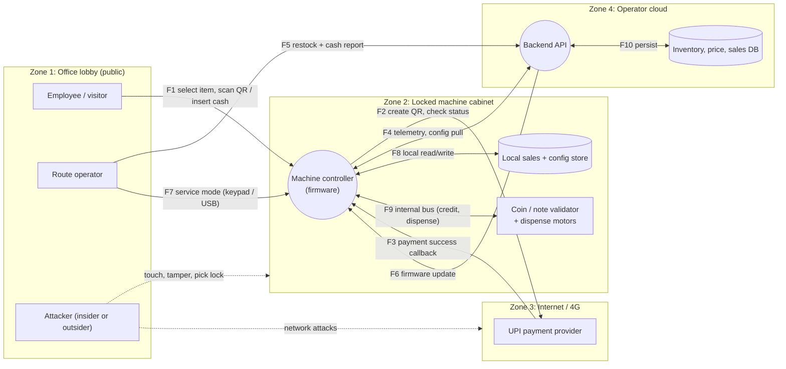
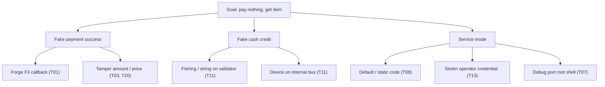
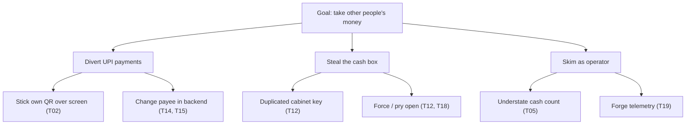

# Worked Example: Threat Model of an Office Vending Machine (Part 4)

**Series:** [1 Basics](01-basics.md) · [2 Frameworks](02-frameworks.md) · [3 Run a session](03-process.md) · 4 Vending machine (this page) · [5 Automation](05-automation.md)

We apply the 4 questions to a smart vending machine in an office lobby. Method: DFD → STRIDE per element → attack trees → L × I scoring → privacy check.
This is a learning model with assumed design choices; a real machine's design will differ.

## Q1. What are we working on?

### The system
A snack/drink machine in an Indian office lobby:
- Pays by **UPI dynamic QR** shown on a screen (and **cash** via coin/note validator).
- A **controller** (embedded Linux) runs the UI, takes payments, drives the dispensing motors.
- A **4G modem** sends telemetry to the operator's **cloud backend** and pulls price and config updates and **firmware updates**.
- A **route operator** restocks, collects cash and uses an **operator app**. A **service mode** (keypad/USB) exists for maintenance.

### Scope
| In scope | Out of scope |
|---|---|
| Machine hardware and firmware | Internals of the UPI provider and banks |
| UPI payment flow, cash handling | Office Wi-Fi and building security (machine uses its own 4G SIM) |
| Telemetry, config, firmware update | Product supply chain and food safety |
| Operator app and backend API | |

### Assumptions (write these down; wrong ones cause breaches)
- A1: Machine uses 4G, not the office LAN.
- A2: Anyone in the lobby can touch the front of the machine; only the operator has the cabinet key.
- A3: v1 has **no** employee ID / payroll deduction. (If added, re-model; see T16.)
- A4: No camera guarantee: CCTV may or may not cover the machine.

### Assets
| Asset | Why it matters | C | I | A |
|---|---|:-:|:-:|:-:|
| Money (cash box, UPI settlement) | Direct loss | | ●●● | |
| Payment integrity (right payer, right amount, right payee) | Fraud, disputes | | ●●● | |
| Firmware and config integrity | One flaw can hit every machine | ● | ●●● | ●● |
| Device secrets (API keys, certs) | Impersonate machines | ●●● | ●● | |
| Stock | Shrinkage | | ● | |
| Availability of the machine | Revenue, reputation | | | ●● |
| Operator credentials | Access to many machines | ●●● | ●● | |
| Payer data (UPI ids, purchase history) | Privacy | ●● | | |

### Data Flow Diagram

Trust boundaries: Zone 1 | 2 (door/lock), 2 | 3 (modem), 3 | 4 (internet to cloud).
Key idea: **anything the controller receives from outside the cabinet is untrusted until verified**, and the cabinet itself is only as safe as its lock.

## Q2. What can go wrong?

### Threat actors
| Actor | Skill | Goal |
|---|---|---|
| Curious or opportunistic employee | Low | Free snack, shake the machine |
| Thief | Low–medium | Cash, stock |
| Dishonest operator | Medium (has keys, app access) | Skim cash, hide it |
| Fraudster | Medium | Divert payments (QR swap), fake payments |
| Remote attacker | High | Fleet-wide compromise via firmware/backend |

### Attack trees for top goals

### STRIDE threat table

Scale: L (likelihood) and I (impact) 1–3, Risk = L × I → 1–2 Low, 3–4 Medium, 6–9 **High**.

| ID | Where | STRIDE | Threat | L | I | Risk | Response | Mitigation |
|---|---|:-:|---|:-:|:-:|:-:|---|---|
| **T08** | F7 service mode | E | Static/default keypad code opens service mode: free vend, set prices, add credit | 3 | 3 | **9 H** | Mitigate | No static code. Operator gets a short-lived one-time code via the app; door-open sensor required; every use logged and alerted |
| **T01** | F3 callback | S | Forged "payment success" makes the machine dispense | 2 | 3 | **6 H** | Mitigate | Never trust the callback alone. Backend verifies status with the provider using server credentials, bound to order id + amount + machine id; signed callbacks; dispense only on verified result |
| **T02** | Screen / QR | T | Attacker covers the screen or sticker with own QR; payments go to attacker | 3 | 2 | **6 H** | Mitigate | Dynamic QR on a tamper-evident screen only; no printed static QR; payee name shown on machine and in the UPI app; routine inspection |
| **T06** | Controller | I | Keys and certs extracted via USB/serial/SD; shared fleet key means all machines impersonated | 2 | 3 | **6 H** | Mitigate | Per-device credentials in a secure element/TPM; no shared key; encrypted storage; revocation |
| **T07** | Controller | E | UART/JTAG/ADB debug left enabled gives a root shell | 2 | 3 | **6 H** | Mitigate | Disable or fuse debug; secure boot; tamper switch on cabinet door |
| **T09** | F6 firmware | T, E | Unsigned or MITM firmware puts attacker code on all machines | 2 | 3 | **6 H** | Mitigate | Signed firmware verified on device; secure boot; TLS with pinning; rollback protection |
| **T10** | F6 firmware | D | A bad update bricks the whole fleet | 2 | 3 | **6 H** | Mitigate | Staged rollout; A/B partitions with auto-rollback; kill switch |
| **T12** | Cabinet lock | S, E | Common or copied key opens cabinet: cash theft, stock theft, hostile device planted | 3 | 2 | **6 H** | Mitigate + reduce | Unique keys or electronic lock with audit; door sensor and alert; push users to cashless to reduce cash held |
| T03 | F2 | T | Amount or price tampered so a ₹40 item costs ₹1 | 2 | 2 | 4 M | Mitigate | Backend creates the order and sets the amount; controller can't choose; reconcile payment vs dispense |
| T20 | F8 local store | T | Offline edit of price/sales table (removed storage) | 2 | 2 | 4 M | Mitigate | Backend is the source of truth; signed config; integrity check at boot |
| T04 | Dispenser | R | "I paid, nothing came out" (or false claim); no proof | 3 | 1 | 3 M | Mitigate (process) | Log dispense-sensor event with order id; refund flow; machine id on screen for support |
| T05 | Cash handling | R | Cash count differs; operator denies; no audit trail | 2 | 2 | 4 M | Mitigate | Numbered sealed cash boxes; count signed in the app; reconcile with cash sales telemetry; dual control |
| T11 | F9 / validator | S, T | Fishing line or string, coin replay, or a device on the internal bus fakes "credit inserted" | 3 | 1 | 3 M | Mitigate + accept residual | Anti-fishing validator; tamper switches; locked cabinet; alert on credit without cash counted |
| T13 | F5 operator app | S | Phished operator account: false reports, access to many machines | 2 | 2 | 4 M | Mitigate | MFA; device binding; least privilege per route; login alerts |
| T14 | Backend API | E | Operator of route A reads or edits route B's machines (IDOR) | 2 | 2 | 4 M | Mitigate | Object-level authorization on every request; negative tests |
| T15 | Backend API | T, E | Mass assignment on machine config lets a user set `price=0` or enable service mode | 2 | 2 | 4 M | Mitigate | DTOs with allow-listed fields; see [Mass Assignment](../03-access-control/mass-assignment.md) |
| T16 | Backend logs | I (privacy: Linking, Identifying) | Storing payer UPI ids links purchases to a person (dietary or health habits, attendance patterns) | 2 | 2 | 4 M | Mitigate | Don't store payer ids; keep only order id and amount; short retention |
| T18 | Cabinet / body | D | Vandalism, shaking, kicking | 2 | 2 | 4 M | Transfer + accept | Tilt sensor; CCTV coverage; insurance; accept minor damage |
| T17 | Modem | D | 4G jam or SIM removal; undefined behaviour while offline | 2 | 1 | 2 L | Mitigate | Fail closed for cashless, cash-only allowed; heartbeat alert; SIM locked to device |
| T19 | F4 telemetry | T | Forged or replayed telemetry hides theft | 1 | 2 | 2 L | Mitigate | Signed messages with timestamp and nonce |

Totals: 8 High, 10 Medium, 2 Low.

### Open questions this exposed (found by drawing the DFD)
1. Is the **F3 callback** authenticated? (T01)
2. Is **firmware** signed and verified on the device? (T09)
3. Does **service mode** use a fixed code? (T08)
4. What does the machine do **offline**? (T17)

If you can't answer these, that *is* the finding. A threat model that produces good questions is working.

## Q3. What are we going to do about it?

### Priority order
Rank by risk, then by cost to fix:

| Order | Threats | Why first |
|---|---|---|
| 1 | T08 | Highest score, simple fix (remove static code, issue one-time codes) |
| 2 | T01, T03 | Payment correctness; mostly backend design, cheap now, hard after launch |
| 3 | T09, T10, T06, T07 | Fleet-wide impact; must be designed into the firmware pipeline |
| 4 | T02, T12 | Real-world physical fraud; cheap process and hardware changes |
| 5 | Medium items | Backlog with owners |

### Responses summary
| Response | Threats |
|---|---|
| Mitigate | Most |
| Eliminate | Option: remove remote price edit to kill T15 and shrink T14 |
| Transfer | T18 vandalism (insurance) |
| Accept (record who and why) | Residual of T11 (small, low-value fishing losses) |

### Security requirements derived (examples)
- SR1: Service mode requires a one-time code valid ≤ 10 minutes and an open-door signal; each use creates an alert.
- SR2: The machine dispenses only after the backend confirms payment for the **same** order id, amount and machine id.
- SR3: The device installs only firmware whose signature verifies against a key in secure storage; failed boot rolls back.
- SR4: No credential on a machine is valid for any other machine.
- SR5: The backend never accepts price, role or machine-owner fields from a client write request.

## Q4. Did we do a good enough job?

### Verification: how each top mitigation is tested

| Threat | Test |
|---|---|
| T08 | Try old/default codes; reuse an expired code; open service mode with the door closed |
| T01 | Replay a captured success callback; send a callback with the wrong amount or order id; no callback at all |
| T03 | Modify the amount in the request; confirm the provider charge matches the price table |
| T09 | Serve a modified or unsigned image on a test rig; confirm the device rejects it and rolls back |
| T06 | Extract storage from a test unit; confirm no reusable fleet credential |
| T14/T15 | Cross-route access test; send extra fields (`price`, `serviceMode`) in config writes |
| T02, T12 | Physical walk-through: can the screen cover be swapped unnoticed? Does every machine need a different key? |

### Review checklist
- [ ] Does the DFD match the real machine (open one up)?
- [ ] Every threat has an owner and a decision?
- [ ] Are the 4 open questions answered?
- [ ] Tickets exist for all High threats?
- [ ] Did we think about *people* (operator, cleaner, vendor), not just attackers?

### Revisit this model when
Employee ID/payroll payments are added (new personal data) · a new payment method · a new firmware pipeline or vendor · a new region or office · a theft or fraud incident · every 12 months.

## What to take away
1. Drawing the diagram surfaced the questions (callback, firmware, service mode) before any tool was run.
2. The worst risks were *design and physical* issues (static code, QR sticker, lock), which scanners never find.
3. Every threat ended with a decision, an owner and a test.
4. The same method works for a payments API or a mobile app. Only the diagram changes.

Next: [Part 5: Automation and tools](05-automation.md) (we encode this exact model in code)

---
Credit: method per the OWASP Threat Modeling Cheat Sheet (CC BY-SA 4.0); the vending machine model, threats and scores are my own illustrative analysis, not a real product assessment.
