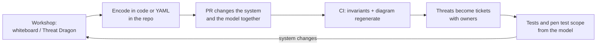

# Threat Modeling Automation and Tools (Part 5)

**Series:** [1 Basics](01-basics.md) · [2 Frameworks](02-frameworks.md) · [3 Run a session](03-process.md) · [4 Vending machine](04-vending-machine.md) · 5 Automation (this page)

## What can and cannot be automated

| Automatable | Needs a human |
|---|---|
| Keeping the diagram in sync with a code definition | Deciding what the system *really* does |
| Generating DFDs and reports | Judging which threats matter in *this* context |
| Suggesting candidate threats from a library | Rating risk and choosing responses |
| Checking invariants ("every network flow is encrypted") on every PR | Physical, process and people threats |
| Tracking threats as tickets | Accepting risk |

Mental model: **tools give you candidates and guardrails; people make the decisions.**

## Tool landscape

| Tool | Type | Good for | Notes |
|---|---|---|---|
| [OWASP Threat Dragon](https://github.com/OWASP/threat-dragon) | Free, Apache-2.0. Web app and desktop app | Drawing DFDs and recording threats/mitigations with a team | Web version can store model files in GitHub/GitLab/Bitbucket; run with npm or Docker |
| [pytm](https://github.com/OWASP/pytm) | Free. Python library ("threat model as code") | Models in git, diffs in PRs, CI checks, generated DFD/report | Needs Graphviz for DFDs; Java + PlantUML for sequence diagrams; pandoc for reports |
| [Threagile](https://github.com/Threagile/threagile) | Free, MIT. YAML model, run via Docker | Describing architecture in YAML and getting a risk report (PDF, Excel, JSON) | Check release and commit activity before adopting |
| Microsoft Threat Modeling Tool | Free desktop app (Windows) | Classic STRIDE workflow | Check its current maintenance status before relying on it |
| IriusRisk, ThreatModeler | Commercial platforms | Large orgs: libraries, compliance mapping, workflow integration | Cost and lock-in; evaluate against your scale |
| Elevation of Privilege, OWASP Cornucopia | Card games | Workshops, engaging developers | No tooling needed |
| Mermaid, draw.io | Diagramming | Diagrams in docs (what these notes use) | Not threat tools by themselves |

**My recommendation for a learner / small team:** Threat Dragon for team sessions and visuals, pytm for models in code and CI. Look at Threagile if you want YAML plus a built-in rule set.

## Hands-on: the vending machine as code with pytm

Files (in the repo): [`examples/threat-modeling/vending_machine_tm.py`](https://github.com/rootranjan/appsec-simplified/blob/main/examples/threat-modeling/vending_machine_tm.py) and [`tm_gate.py`](https://github.com/rootranjan/appsec-simplified/blob/main/examples/threat-modeling/tm_gate.py).

### Setup
```bash
cd examples/threat-modeling
python3 -m venv .venv && .venv/bin/pip install pytm
```

### The model (excerpt)
```python
from pytm import TM, Actor, Boundary, Dataflow, Server

tm = TM("Office Vending Machine")
lobby, cabinet = Boundary("Office lobby"), Boundary("Locked machine cabinet")

employee = Actor("Employee or visitor");  employee.inBoundary = lobby
controller = Server("Machine controller"); controller.inBoundary = cabinet

fw = Dataflow(backend, controller, "Firmware update")
fw.protocol = "HTTPS"
fw.controls.isEncrypted = True
fw.controls.authenticatesSource = False   # open question from the threat model: is firmware signed?
```
Our open questions from part 4 (T01 callback, T09 firmware) are now **properties in code**.

### Generate things
```bash
.venv/bin/python vending_machine_tm.py --list                      # threat catalog pytm knows
.venv/bin/python vending_machine_tm.py --json tm.json              # findings as JSON
.venv/bin/python vending_machine_tm.py --dfd | dot -Tpng -o dfd.png   # needs Graphviz (brew install graphviz)
```

### What happened when I ran it
- `--json` produced **134 candidate findings** (8 Very High, 41 High, 76 Medium, 9 Low/Very Low).
- Most are generic web-app items (SSI injection, XSS, path traversal) matched against the controller and backend. Many don't apply to an embedded device.
- **Lesson:** a generic library gives noise. You still triage, and the real value is in *your* custom checks below. Our hand-made analysis in part 4 found physical and design threats (static service code, QR sticker, lock keys) that the library cannot know about.
- Gotcha: in my run with pytm 1.4.0, the `flows` section of the JSON showed default values for flow attributes I had set, while the in-memory model was correct. So the gate below imports the model instead of parsing the JSON.

### A custom CI guardrail: "no unauthenticated or unencrypted network flow"
[`tm_gate.py`](https://github.com/rootranjan/appsec-simplified/blob/main/examples/threat-modeling/tm_gate.py):
```python
import vending_machine_tm as model
from pytm import TM

NON_NETWORK = {"Physical", "Local"}
problems = []
for flow in TM._flows:
    if flow.protocol in NON_NETWORK:
        continue
    if not flow.controls.isEncrypted:
        problems.append(f"{flow.name}: not encrypted")
    if not flow.controls.authenticatesSource:
        problems.append(f"{flow.name}: source not authenticated")
```
Result on our model:
```text
FAIL: Payment success callback: source not authenticated
FAIL: Firmware update: source not authenticated
exit=1
```
It flags exactly the two open questions (T01, T09). Fix the design, set the control to `True` after the code really does it, and the gate passes. If someone later changes a flow to unencrypted, the build fails.

### Run it in CI (GitHub Actions)
Template, not yet run in CI. It fails today by design until T01 and T09 are fixed, so add it to a branch, not `main`:
```yaml
name: threat-model-gate
on: [pull_request]
jobs:
  gate:
    runs-on: ubuntu-latest
    steps:
      - uses: actions/checkout@v4
      - uses: actions/setup-python@v5
        with: { python-version: "3.x" }
      - run: pip install pytm
      - run: python tm_gate.py
        working-directory: examples/threat-modeling
```

## A practical threat-modeling-as-code workflow



1. **Workshop first** (part 3). Don't start with the tool.
2. **Encode the stable facts** (components, flows, boundaries, controls) in code.
3. **Write invariants** that matter to you (encryption, auth, no secrets in flows, every flow crossing a boundary has an owner).
4. **Review the model in PRs** like code. A flow added without authentication should be visible in the diff.
5. **Keep human-written threats** (like the T01–T20 table) next to the code: the model catches regressions, the table holds the reasoning.
6. **Link to ASPM:** map each threat id to a ticket and to a test or scanner rule.

## Using AI assistants (carefully)
- Good for: first-draft threats from a DFD description, STRIDE prompts per element, turning a table into test cases.
- Risks: generic or confident-but-wrong threats; it doesn't know your real design. Don't paste confidential architecture into tools your company hasn't approved.
- Rule: AI proposes, a human who knows the system accepts or rejects each item.

## Learning resources
- [OWASP Threat Modeling Cheat Sheet](https://cheatsheetseries.owasp.org/cheatsheets/Threat_Modeling_Cheat_Sheet.html)
- [Threat Modeling Manifesto](https://www.threatmodelingmanifesto.org/)
- [SEI: Threat Modeling, A Summary of Available Methods](https://www.sei.cmu.edu/library/threat-modeling-a-summary-of-available-methods/)
- [LINDDUN](https://linddun.org/) for privacy
- Book: *Threat Modeling: Designing for Security* by Adam Shostack
- [OWASP Threat Dragon](https://owasp.org/www-project-threat-dragon/) · [pytm](https://github.com/OWASP/pytm) · [Threagile](https://github.com/Threagile/threagile)

## Practice ideas (to turn into videos)
1. Threat model a login + password reset flow (use [Authentication]notes later).
2. Threat model a UPI-style payment API (callbacks, idempotency, amount tampering).
3. Take your own team's feature and run the 90-minute session from part 3.
4. Add a second invariant to `tm_gate.py` (e.g. "every Datastore holding PII has encryption at rest").

---
Credit: tool facts from each project's own README/site; process from the OWASP Threat Modeling Cheat Sheet (CC BY-SA 4.0).
